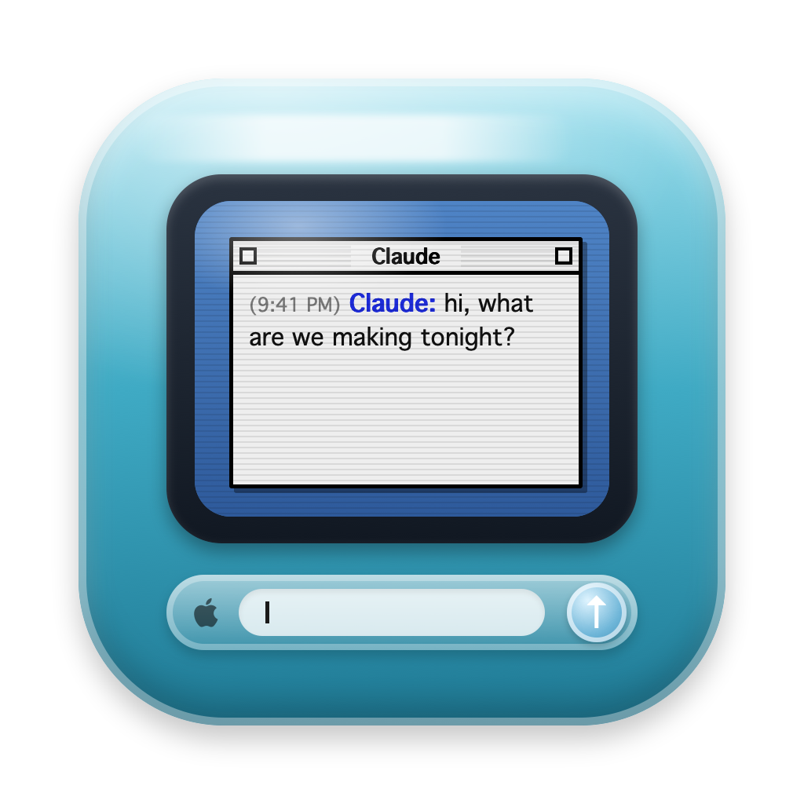
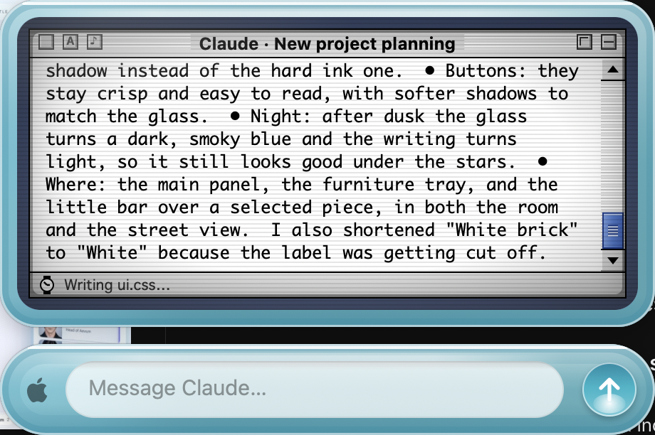
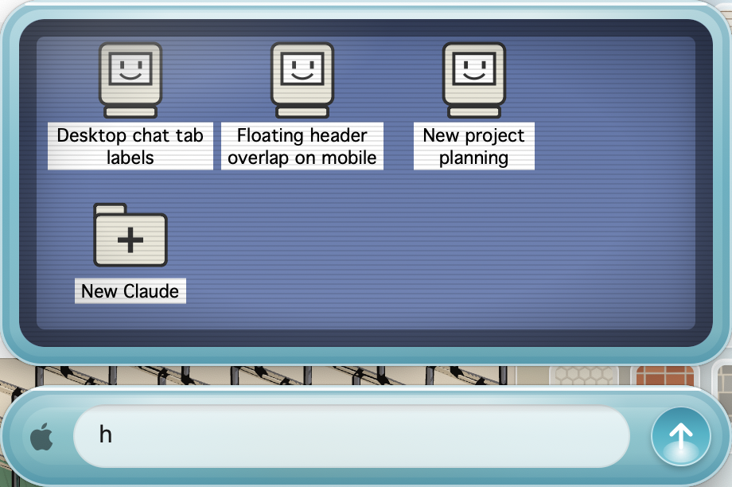
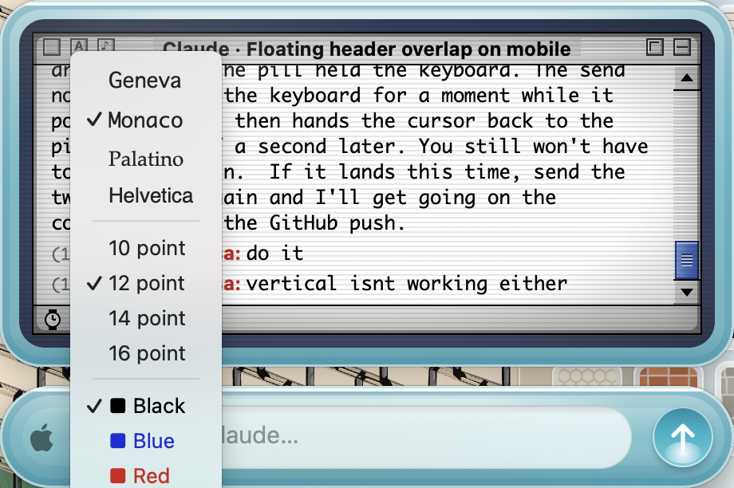
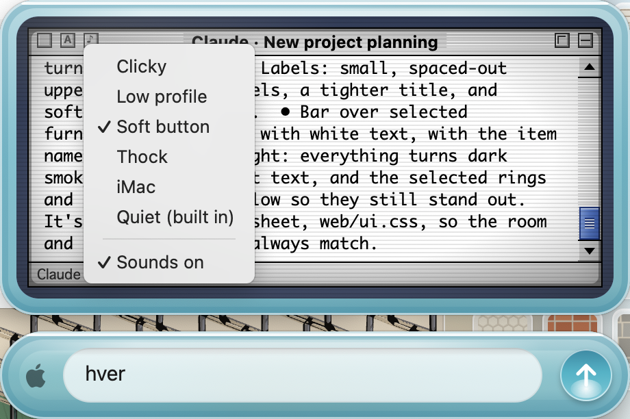
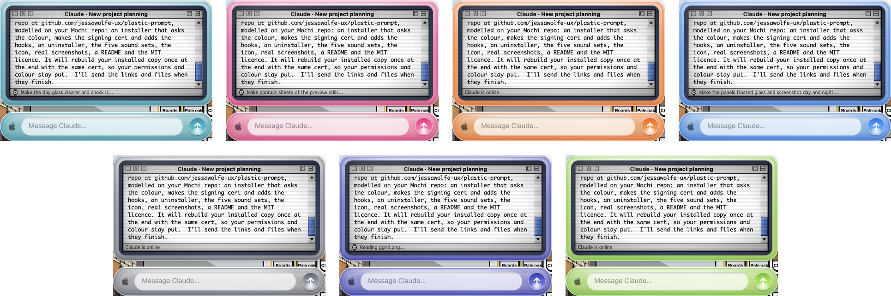

<p align="center"></p>

<h1 align="center">Plastic Prompt</h1>
<p align="center"><b>A Claude Code prompt widget that looks like a 1998 iMac.</b></p>

---

Translucent coloured plastic, an OS 9 screen with an AIM-style chat log, and a plastic pill to type in. It floats over everything on your Mac. Type in the pill, press Return, and your message goes to **Claude Code** running in Terminal, without Terminal coming forward. Claude's replies show up on the little screen, with a wristwatch and a one-line "what it's doing" while it works.

<p align="center"></p>

## What it does

- 💬 **Message Claude from anywhere.** The pill sends to the Terminal tab running Claude. Terminal stays where it is.
- 📺 **Replies on the screen.** Timestamps, your name in red, Claude in blue, an OS 9 scrollbar, and a status line with a spinning watch while Claude works.
- 🖥 **A desktop of chats.** Click the box at the top left of the window and the screen goes back to the blue desktop: one little Mac for every Terminal tab running Claude, labelled by what that chat is about, plus a **New Claude** folder that opens a new tab in a folder you pick. Each tab keeps its own log, and a red dot marks one that answered while you were elsewhere.
- 🔤 **The A box:** Geneva, Monaco, Palatino or Helvetica, four sizes, seven colours.
- 🎹 **The ♪ box:** typing sounds. Five sets of real key clicks (made with ElevenLabs), from a soft cushioned button to a deep thock, or a quiet built-in one, or off.
- 🔔 **Sounds of the era.** A boot chime with the happy Mac, a creak when you send, a bling when Claude answers, and the beep.
- 🎨 **Seven plastics.** Bondi blue, Strawberry, Tangerine, Blueberry, Graphite, Indigo and Key Lime, from the right-click menu.
- 🌅 **Open at Login**, remembers where you put it, and persists the chat.

<p align="center"></p>

| | |
|---|---|
|  | **The A box:** font, size and colour for the log. |
|  | **The ♪ box:** pick the key sound, or turn sounds off. |

<p align="center"></p>

## How it works

Plastic Prompt is one Swift file. It talks to Claude Code through **Terminal**: it pastes your message into the tab that's running `claude` (if none is, it opens one with `claude --continue`). Replies and progress come from a few **Claude Code hooks** (`hooks/notify.py`) that write small JSON files into `~/Library/Application Support/PromptBar/`, which the widget watches. The same hooks power [Mochi](https://github.com/jessawolfe-ux/mochi), so if you have her, nothing is added twice.

No accounts, no servers. Nothing leaves your Mac.

## Install

You need a Mac (macOS 14 or newer) and [Claude Code](https://docs.claude.com/en/docs/claude-code) installed.

Open **Terminal** and run:

```bash
git clone https://github.com/jessawolfe-ux/plastic-prompt.git
cd plastic-prompt
./install.sh
```

No git? Click the green **Code** button above → **Download ZIP**, unzip it, then in Terminal `cd` into the folder and run `./install.sh`.

The installer will:

1. Ask **which plastic** you want 🎨
2. Build the app (about 30 seconds) and put it in `~/Applications`
3. Connect it to Claude Code by adding a few hooks to `~/.claude/settings.json` (your old settings are backed up first)

### Permissions

Two, once:

- **Accessibility:** System Settings → Privacy & Security → Accessibility → turn on **Plastic Prompt**. This is how it types into Terminal without bringing Terminal forward.
- **Automation:** the first time you send a message, macOS asks to let Plastic Prompt control **Terminal** and **System Events**. Say OK to both.

The app is signed with a certificate the installer makes just for your Mac (kept in your login keychain), so macOS remembers these permissions through rebuilds and updates.

## Using it

| | |
|---|---|
| **Type + Return** | Send to Claude. The cursor stays in the pill for the next line. |
| **Esc** | Clear the pill and go back to what you were doing |
| **Drag** | Move it anywhere; it remembers the spot |
| **Close box** (top left of the window) | The desktop of Claude tabs. Double-click a Mac to switch, or **New Claude** to open one |
| **A box / ♪ box** | Font and sound menus |
| **Right-click** (or the menu-bar Mac) | Colour, sounds, replay the boot, clear chat, show/hide, Open at Login, quit |

If a message doesn't arrive, right-click → **Bring Terminal forward when sending** switches to the older way, which activates Terminal for a moment.

## Updates

```bash
cd plastic-prompt && ./install.sh --update
```

## Make it yours

Everything is in `PlasticPrompt.swift`: the plastic, the CRT, the chime, the sounds. Change anything, then run `./build.sh` (which is `./install.sh --rebuild`) to rebuild and relaunch with your colour and permissions kept.

The key sounds live in `sfx/<set name>/`: `key_*.wav` for letters, `deep_*.wav` for space, delete and return, `up_*.wav` for letting go. Drop a new folder of WAVs in there and it shows up in the ♪ menu after a rebuild.

## Uninstall

```bash
./uninstall.sh
```

Removes the app, its settings and its hooks. If you also have Mochi, her hooks stay.

## Credits

The key clicks were generated with [ElevenLabs](https://elevenlabs.io) sound effects. The chime, creak, bling and beep are synthesized in the app, as a tribute, not a copy. Not affiliated with Apple.

---

<p align="center">Made with 💾 by <a href="https://jessa.art">Jessa Wolfe</a>.</p>
